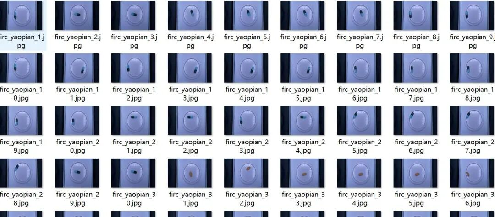
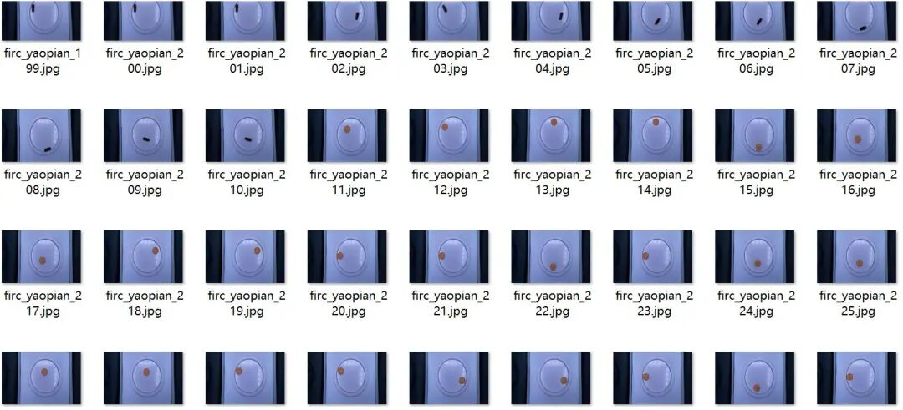
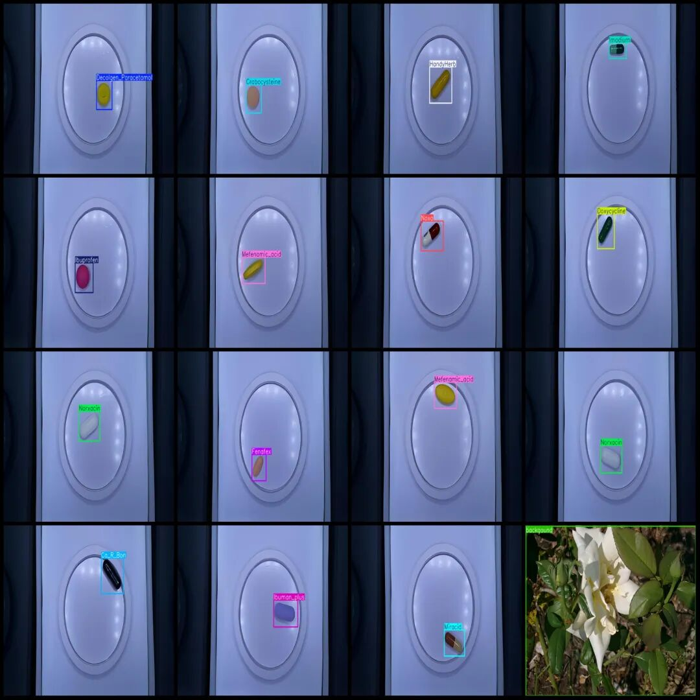
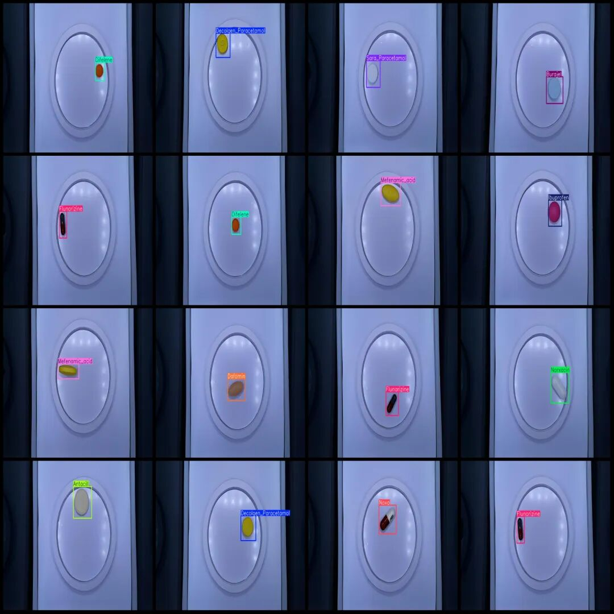

# Intelligent Medical Pill Types Detection Dataset VOC+YOLO format with 930 images and 31 categories

Dataset format: Pascal VOC format + YOLO format (txt file without split path, only containing jpg images and corresponding VOC format xml files and yolo format txt files)

Number of images (number of jpg files): 930

Number of annotations (number of xml files): 930

Number of annotations (number of txt files): 930

Labeling category count: 31

Annotation Category Names: ["Amoxicillin", "Antacill", "Burajel", "Ca_R_Bon", "Celebrex", "Centrum_Multivitamin", "Cetrizin", "Chlorpheniramine", "Crabocysteine", "Dafomin", "Decolgen_Paracetamol", "Difelene", "Doxycycline", "Fenafex", "Flunarizine", "Gaszym", "Glutamax", "HandyHerb", "Heromycin", "Ibuman_plus", "Ibuprofen", "Imodium", "Lamotrigine", "Mefenamic_acid", "Miracid", "Norxacin", "Noxa", "Sara_Paracetamol", "Simvastatin", "Volta", "background"]

Number of boxes labeled in each category:

Amoxicillin Frames = 31

Antacill frame count = 30

Burajel frame count = 30

Ca_R_Bon frame count = 30

Celebrex frame count = 30

Centrum_Multivitamin Frames = 30

Cetrizin frame count = 29

Chlorpheniramine box count = 30

Crabocysteine frame count = 30

Dafomin Frames = 30

Decolgen_Paracetamol Frames = 30

Difelene frame count = 30

Doxycycline Frames = 30

Fenafex frame count = 30

Flunarizine Frames = 30

Gaszym frame count = 30

Glutamax frame count = 30

HandyHerb Frame Count = 30

Heromycin frame count = 29

Ibuman_plus Frame Count = 29

Ibuprofen Frames = 30

Imodium frame count = 30

Lamotrigine Frames = 30

Mefenamic_acid Frames = 30

Miracid Frame Count = 30

Norxacin Frames = 30

Noxa Frame Count = 30

Sara_Paracetamol Frames = 30

Simvastatin Frames = 30

Volta frame count = 31

Background Frame Count = 31

Total frame count: 930

Number of images per category:

Amoxicillin (Amoxacillin) occupies the number of images = 31

Antacill (Antacid) occupies a picture count = 30

Burajel (Brahel) occupies a picture count = 30

Ca_R_Bon (Calbon) occupies a picture count = 30

Celebrex (celecoxib) has 30 images.

Centrum_Multivitamin (Sanoline Complex Vitamin) - Pictures = 30

Cetrizin (cetirizine) occupies the image count = 29

Chlorpheniramine (Chlorpheniramine) occupies a picture count = 30

Crabocysteine (Carbocylcysteine) occupies a picture count = 30

Dafomin (Dafonin) occupies a picture count = 30

Decolgen_Paracetamol (Decologen Paracetamol) occupies a picture count = 30

Difelene (Difene) occupies a picture count = 30

Doxycycline (Doxycycline) occupies a picture count = 30

Fenafex (non-nafex) holds 30 images.

Flunarizine (flunarizine) occupies a picture count = 30

Gaszym (Gaszym) has 30 images.

Glutamax (glutamine max) occupies a picture count = 30

HandyHerb (convenient herbal) occupies a picture count = 30

Heromycin (Heromycin) occupies a picture count = 29

Ibuman_plus (ibuprofen enhanced version) occupies 29 images.

Ibuprofen (Brufen) occupies a picture count = 30

Imodium (imodium) has 30 images.

Lamotrigine (Lamotrigine) occupies a picture count = 30

Mefenamic acid (Fenalac) occupies a picture count of 30.

Miracid (Miracid) has 30 images.

Norxacin (Norfloxacin) occupies a picture count = 30

Noxa (Nox) owns 30 images.

Sara_Paracetamol (Sara Acetaminophen) occupies a picture count = 30

Simvastatin (Simvastatin) occupies a picture count = 30

Volta (Volta) occupies a picture count = 31

Background (background) occupies = 31

Image resolution: 720x480

Using labelImg:

Annotation rules: Draw a rectangle around the category.

Important Notice: The dataset does not have separate training, validation, and test sets; you need to partition them yourself.

Special : This dataset does not guarantee the accuracy of the trained models or weight files.

Image Preview:

Annotation example:

## Payment

Here is a pay link on Stripe ( https://buy.stripe.com/3cs8yP7sY87d0vu9AB ). Please contact me lonlonago@foxmail.com after funding $89, and I will send you a complete data files , thank you!

